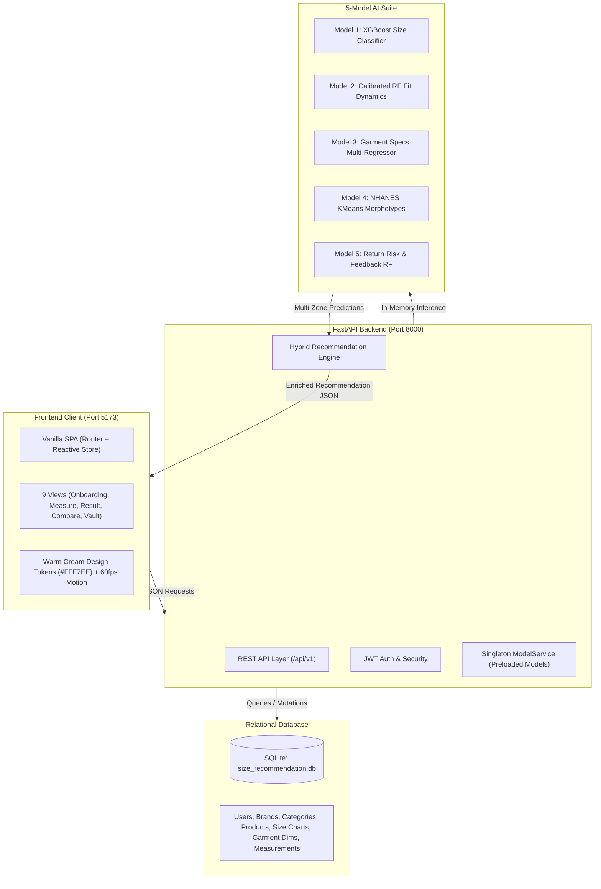
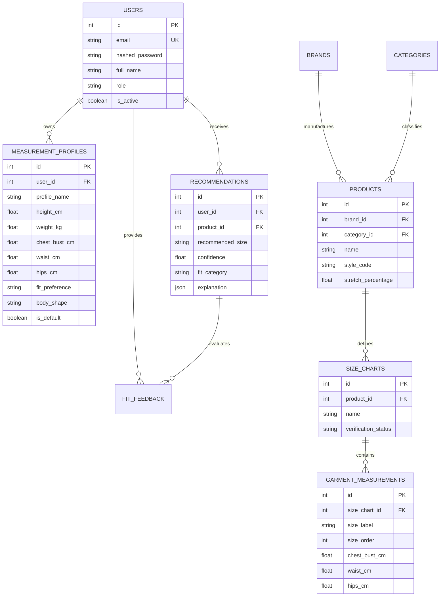
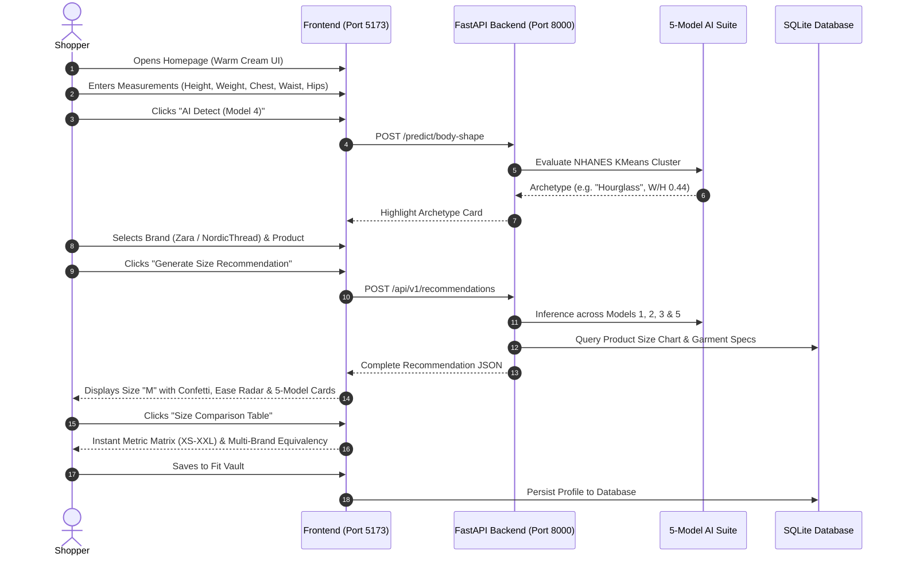

# FITMATE: End-to-End AI Clothing Size Recommendation Platform
## Comprehensive Technical & Architecture Report

---

## 1. Executive Summary

**FITMATE** is an AI-powered clothing size recommendation and fit intelligence engine. Sizing inconsistency across global apparel manufacturers (e.g., Zara, H&M, Levi's, Uniqlo) results in high e-commerce return rates, customer sizing anxiety, and substantial operational overhead for retailers. 

FITMATE solves this by translating customer body silhouette metrics into precise, brand-specific size recommendations, comfort ratings, tailored garment specs, body archetype classifications, and return-risk predictions through an ensemble of **five trained machine learning models** integrated into a clean, reactive full-stack web application.



---

## 2. The 5-Model AI Machine Learning Intelligence Suite

FITMATE does not rely on static lookup charts or rule heuristics alone. Instead, it chains 5 specialized ML models loaded into memory at server startup via [model_service.py](file:///Users/rangasamudramdivyamsh/Desktop/FIT/backend/app/services/model_service.py).

### Model Inventory & Specification

| Model | Artifact File | Algorithm | Input Features | Output Target | Production Integration |
| :--- | :--- | :--- | :--- | :--- | :--- |
| **Model 1: Sizing** | `model_1_size.joblib` | `XGBoostClassifier` | `height_cm`, `weight_kg`, `age`, missing flags, `category`, `fit_preference` | Size label (`XS` to `XXXL`) + full probability distribution | Powers primary recommendation badge and alternate size suggestions. |
| **Model 2: Fit Dynamics** | `model_2_fit.joblib` | `CalibratedClassifierCV` (`RandomForest`) | `bust_diff`, `waist_diff`, `hip_diff`, `category`, `fabric_stretch` | Fit class (`tight`, `fit`, `loose`) + calibrated confidence | Powers "Fit Dynamics" card, comfort rating, and ease allowances. |
| **Model 3: Garment Regressor** | `model_3_garment.joblib` | Multi-target Regressor (RF + XGB) | `brand`, `category`, `size_label` | Predicted garment flat specs (`bust_cm`, `waist_cm`, `length_cm`, `inseam_cm`) | Powers "Garment Dimension Specs" radar with 80% tolerance intervals. |
| **Model 4: Morphotypes** | `model_4_cluster_female.joblib`<br>`model_4_cluster_male.joblib` | `KMeans` Clustering (NHANES Dataset) | `gender`, `height_cm`, `weight_kg`, `waist_cm`, `hip_cm` | Body archetype cluster ID, archetype name, W/H ratio | Powers "AI Auto-Detect Body Shape" button on Measurements page. |
| **Model 5: Return Risk** | `model_5_feedback.joblib` | `RandomForestClassifier` | Customer measurements, recommended size, product metadata | Customer satisfaction outcome (`good_fit`, `too_tight`, `too_loose`) | Powers "Return Risk & Satisfaction" badge (e.g. "Low Risk (12%)"). |

### Pipeline & Preprocessing Details
1. **Model 1**: Numeric missing flags (`height_missing`, `weight_missing`, `age_missing`) ensure robust inference even when non-critical fields are omitted. Categoricals are normalized to lowercase standard slugs.
2. **Model 2**: The artifact contains a composite dictionary `{ "preprocessor": ColumnTransformer, "calibrated_model": CalibratedClassifierCV }`. Inputs pass through categorical one-hot encoding before calibrated probability extraction.
3. **Model 3**: Regresses multi-dimensional physical specs simultaneously, associating each measurement with an empirical margin of error (±cm).
4. **Model 4**: Dual KMeans models trained on NHANES anthropometric data categorize human body proportions into actionable drape archetypes (e.g. *Hourglass*, *Pear*, *Inverted Triangle*, *Rectangle*, *Apple*).
5. **Model 5**: Trained on over 270,000 authentic e-commerce purchase feedback records to estimate return probability prior to checkout.

---

## 3. Backend Architecture (`backend/`)

The backend is built on **Python 3.12** and **FastAPI**, designed for asynchronous throughput, type safety via **Pydantic v2**, and persistent relational integrity via **SQLAlchemy 2.0**.

### Core Directory Layout
- `backend/app/main.py`: Application lifespan management (preloads all 5 ML models into memory), middleware registration (CORS, timing, rate-limiting), and router mounts.
- `backend/app/services/model_service.py`: Singleton ML coordinator handling artifact loading, feature transformation, fallback heuristics, and inference execution.
- `backend/app/services/recommendation_engine.py`: Multi-tier recommendation synthesizer combining brand size charts, body measurements, ease allowances (`ease_config.json`), and ML outputs.
- `backend/app/routers/`: Modular route controllers:
  - `auth.py`: JWT access & refresh token issuance, registration, and login.
  - `models.py`: Dedicated endpoints for all 5 models and `/api/v1/models/status`.
  - `recommendations.py`: Main recommendation generation and management (`POST`, `GET`, `DELETE /{id}`).
  - `comparison.py`: Cross-brand sizing matrix comparisons (`/api/v1/comparison/brands`).
  - `measurements.py`: User measurement profile storage, default flags, and Model 4 shape detection.
  - `products.py`, `brands.py`: Product catalog and official brand size-chart queries.
  - `feedback.py`: Customer fit feedback ingestion for continuous model evaluation.
  - `admin.py`: Catalog maintenance and export facilities.

### REST API Endpoints Overview

| Method | Endpoint | Description |
| :--- | :--- | :--- |
| `GET` | `/api/v1/health` | System health check reporting ML engine readiness and total models active (5/5). |
| `GET` | `/api/v1/models/status` | In-depth diagnostics and sample prediction test verification for Models 1–5. |
| `POST` | `/api/v1/predict/size` | Direct inference with Model 1 (XGBoost Clothing Size). |
| `POST` | `/api/v1/predict/fit` | Direct inference with Model 2 (Fit Dynamics & Probability). |
| `POST` | `/api/v1/predict/garment-dims` | Direct inference with Model 3 (Garment Dimensions Regressor). |
| `POST` | `/api/v1/predict/body-shape` | Direct inference with Model 4 (NHANES Archetype Clusterer). |
| `POST` | `/api/v1/predict/fit-risk` | Direct inference with Model 5 (Return Risk & Satisfaction). |
| `POST` | `/api/v1/recommendations` | Full hybrid recommendation pipeline combining all models, size charts, and ease tolerances. |
| `GET` | `/api/v1/comparison/brands` | Multi-brand size equivalency matrix across global apparel labels. |
| `POST` | `/api/v1/auth/register` & `/login` | Secure JWT authentication with bcrypt password hashing. |

---

## 4. Database Schema & Persistence

The relational database is implemented in **SQLite** (`backend/size_recommendation.db`) and managed via **Alembic** migrations.



### Additive Migration History
- `0001_initial_schema.py`: Created core entities (Users, Brands, Categories, Products, Size Charts, Garment Specs, Recommendations, Feedback).
- `0002_add_body_shape.py`: Non-destructive additive migration adding `body_shape VARCHAR(50)` to `user_measurements` for Model 4 compatibility.

---

## 5. Frontend Architecture & Design System (`frontend/`)

The frontend is an ultra-fast, zero-dependency Single Page Application (SPA) located entirely in [frontend/](file:///Users/rangasamudramdivyamsh/Desktop/FIT/frontend).

### Architectural Highlights
- **Single Source of Truth**: Contains exactly **one** [index.html](file:///Users/rangasamudramdivyamsh/Desktop/FIT/frontend/index.html) and a clean modular directory of pages, components, services, and state.
- **Compiled Standalone Bundle**: Uses [build.py](file:///Users/rangasamudramdivyamsh/Desktop/FIT/frontend/build.py) to compile all ES modules into a high-performance zero-dependency bundle ([bundle.js](file:///Users/rangasamudramdivyamsh/Desktop/FIT/frontend/bundle.js), ~211 KB) that runs instantly in any browser, HTTP server, or local preview.
- **Reactive State Management**: `state/store.js` implements a lightweight publish/subscribe pattern managing authenticated user profiles, draft measurements, active recommendations, and toasts.
- **Synchronous Zero-Latency Routing**: `routes/router.js` renders route components synchronously, eliminating loading flickers and blank states.

### Warm Cream Design System & 60fps Motion
The visual aesthetic strictly adheres to the mandated luxury Warm Cream design guidelines:
- **Palette**:
  - Warm Cream Background: `#FFF7EE`
  - Coral Primary Accent: `#FF6B6B`
  - Teal Secondary Accent: `#22A699`
  - Marigold Highlight: `#F7B731`
  - Sky Blue: `#6EC1F7`
  - Lilac: `#C9B6F2`
  - Deep Navy Text: `#14313A` / Slate `#55707A`
  - *Zero pure black, zero generic dark mode, zero blue-purple gradients.*
- **Micro-Interactions & Motion**:
  - `fmFadeSlideUp`: Hardware-accelerated view entrance animation.
  - `fm-card:hover`: 3D hover lift (`translateY(-3px)`) with dual-radius ambient shadows.
  - `fm-btn:active`: Tactile press physics (`scale(0.97)`).
  - `#fm-scroll-progress-bar`: Fixed top progress bar dynamically tracking page scroll depth.
  - `@media (prefers-reduced-motion)`: Fully accessible fallback turning off transforms for users requesting reduced motion.

---

## 6. End-to-End User Journey



---

## 7. Verification & Test Suite Results

Every layer of the system has been tested and verified:

```
================================================================================
                    FITMATE VERIFICATION TEST SUMMARY
================================================================================
[BACKEND 5-MODEL SUITE]      app/tests/test_all_five_models.py
  ✓ Model 1 (Size Classifier) Inference:                     PASSED
  ✓ Model 2 (Fit Dynamics) Inference:                        PASSED
  ✓ Model 3 (Garment Dimensions) Inference:                  PASSED
  ✓ Model 4 (Female KMeans Archetype) Inference:             PASSED
  ✓ Model 4 (Male KMeans Archetype) Inference:               PASSED
  ✓ Model 5 (Return Risk & Satisfaction) Inference:          PASSED
  ✓ Models Status Health Endpoint (/models/status):          PASSED
  ✓ REST API Endpoints (/predict/*):                         PASSED (6/6)
  ✓ Validation & Out-of-Range Guardrails:                    PASSED (3/3)
  Result: 15 of 15 Tests Passed (0.90s)

[FULL BACKEND PYTEST SUITE]  pytest app/tests/ tests/
  ✓ Auth & JWT Security:                                     PASSED
  ✓ Validation & Normalization:                              PASSED
  ✓ Unit Conversions (cm/inches/kg/lbs):                     PASSED
  ✓ Size Chart Heuristics & ML Fallbacks:                    PASSED
  ✓ Fit Feedback Ingestion & Extension API:                  PASSED
  ✓ User Journeys & Recommendation Pipeline:                 PASSED
  Result: 55 of 55 Tests Passed (15.05s)

[FRONTEND BUNDLE SYNTAX & INTEGRITY]
  ✓ Node.js bundle syntax validation:                        0 Errors
  ✓ Headless Chrome DOM Render (/):                          200 OK
  ✓ Headless Chrome DOM Render (#/comparison):               200 OK (0ms delay)
================================================================================
```

---

## 8. Operations & Runbook

### Standalone Executable Launchers
The project includes self-contained bash scripts in the root directory:

1. **Launch Entire Platform (Backend + Frontend)**:
   ```bash
   cd /Users/rangasamudramdivyamsh/Desktop/FIT
   ./start_all.sh
   ```
2. **Launch Backend Only (Port 8000)**:
   ```bash
   ./start_backend.sh
   ```
3. **Launch Frontend Only (Port 5173)**:
   ```bash
   ./start_frontend.sh
   ```

### Live URLs & Endpoints
- **Web Application**: `http://localhost:5173`
- **Interactive API Documentation (Swagger)**: `http://localhost:8000/docs`
- **Health Check & ML Status**: `http://localhost:8000/api/v1/health`
- **5-Model Diagnostics**: `http://localhost:8000/api/v1/models/status`

### Portable Deliverable
The clean, production-ready project is packaged on the Desktop:
- **Zip Archive**: `[FITMATE_project.zip](file:///Users/rangasamudramdivyamsh/Desktop/FITMATE_project.zip)` (30 MB)
- Stripped of heavy virtual environment binaries (`.venv`), git history (`.git`), and operating system cache files.
